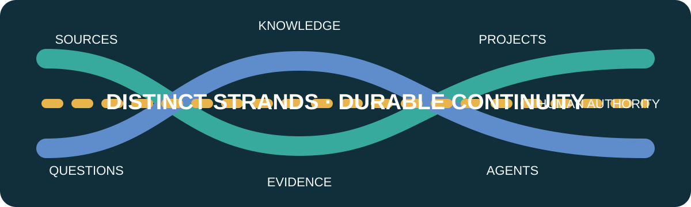
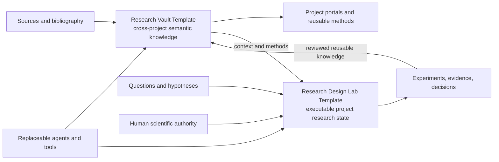
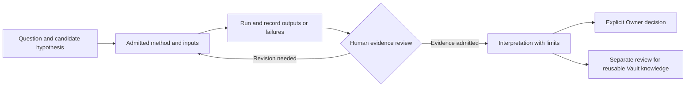

  

<strong>A Git-native research fabric for durable human-agent scientific work.</strong>

English | <a href="README.zh-CN.md">简体中文</a>

  
  
  

<a href="MANIFESTO.md">Manifesto</a> · <a href="docs/architecture/overview.md">Architecture</a> · <a href="#the-template-pair">Components</a> · <a href="docs/philosophy/README.md">Philosophy</a> · <a href="CONTRIBUTING.md">Contributing</a>

> Research state should outlive a chat, an agent, a provider, a workstation, and the assumptions of a single session.

## Why ResearchFabric?

AI-assisted science needs a durable place for questions, evidence, knowledge, terminology, and explicit decisions. Conversation can help produce that state, but conversation is not the state itself. ResearchFabric is an opinionated, minimal-infrastructure approach to AI4S and agent-native research: Markdown and structured metadata, Git review, direct native tools, explicit evidence, and visible authority boundaries.

It treats AI agents as replaceable research assistance and execution substrates. Agents may search, synthesize, implement admitted experiments, and propose interpretations. They do not turn model output into evidence or silently make scientific decisions.

## Architecture

Knowledge and evidence are connected, not interchangeable. The Vault captures reviewed meaning that can travel across projects. The Design Lab keeps a project's hypotheses, methods, runs, evidence, failures, and adopted decisions executable and traceable. Zotero and large-asset systems remain authoritative for the data they manage.

## The Template Pair

| Component | Responsibility | Repository |
| --- | --- | --- |
| RVT — Research Vault Template | Obsidian-compatible, cross-project semantic knowledge and promotion workflows. | [research-vault-template](https://github.com/JerrySkywalker/research-vault-template) |
| RDLT — Research Design Lab Template | Executable project research state: hypotheses, experiments, evidence, and decisions. | [research-design-lab-template](https://github.com/JerrySkywalker/research-design-lab-template) |

ResearchFabric is the public front door, not a third component. The components compose through explicit handoffs and compatible versions—not source copying, submodules, or a runtime parent.

## Start with a repository

| If you need to | Start here |
| --- | --- |
| Keep reviewed terminology, sources, and methods reusable across projects | [Create a Research Vault from the template](https://github.com/JerrySkywalker/research-vault-template/generate). Set the repository identity and visibility, then follow the [Vault specialization guide](https://github.com/JerrySkywalker/research-vault-template/blob/v1.1.0/docs/SPECIALIZATION.md). |
| Maintain one project's questions, runs, evidence, and decisions | [Create a Research Design Lab from the template](https://github.com/JerrySkywalker/research-design-lab-template/generate). Follow the [Lab specialization guide](https://github.com/JerrySkywalker/research-design-lab-template/blob/v1.1.0/docs/SPECIALIZATION.md) and record the exact generation release. |
| Review a template update for an existing repository | Start from the recorded reconciliation point. Compare that exact template release, the target release, and the current instance. Preserve project state and record the reviewed dispositions before advancing reconciliation. [Vault upgrades](https://github.com/JerrySkywalker/research-vault-template/blob/v1.1.0/docs/UPGRADE.md) · [Lab upgrades](https://github.com/JerrySkywalker/research-design-lab-template/blob/v1.1.0/docs/UPGRADE.md). |

## How research moves through the Lab

A run records exact inputs, method, tool versions, and what the result can support. Git preserves changes and review history. Obsidian can help navigate Vault notes, Zotero can manage bibliography and attachments, and large artifacts can stay in external storage with stable references and checksums. These tools are optional and retain their own authority over the data they manage.

## Optional formal mathematics

Use the [Design Lab formal mathematics guide](https://github.com/JerrySkywalker/research-design-lab-template/blob/v1.1.0/docs/FORMAL_MATHEMATICS.md) if a claim benefits from machine checking. A Mathematical Blueprint records the question, definitions, assumptions, and target. The optional Lean/Mathlib example pins its toolchain and dependencies, compares the theorem and dependent definitions to a reviewed lock, and audits transitive axioms. The check covers the formal statement under the recorded assumptions. Human review still governs its meaning and evidence admission, and the Owner decides what the project adopts.

Start with the public [odd-sum Blueprint](https://github.com/JerrySkywalker/research-design-lab-template/blob/v1.1.0/examples/formal-mathematics/BLUEPRINT.md) and [verification method](https://github.com/JerrySkywalker/research-design-lab-template/blob/v1.1.0/examples/formal-mathematics/METHOD.md). A [Vault mathematical note](https://github.com/JerrySkywalker/research-vault-template/blob/v1.1.0/docs/MATHEMATICS.md) can independently link reusable meaning to an exact repository, revision, path, and declaration. Ordinary Vault and Lab use requires no Lean installation.

## Principles

- Research state is not chat history.
- Knowledge is not evidence.
- Assistant recommendation is not an Owner or scientific decision.
- Git makes state durable and reviewable; Git is not proof.
- Research identity should survive providers, agents, machines, sessions, and time.
- Use external bibliography and durable-asset authorities without copying everything into Git.
- Prefer minimal, inspectable infrastructure over middleware without a demonstrated need.

## Maturity

The stable Research Template Pair is `v1.1.0`. The [Vault release](https://github.com/JerrySkywalker/research-vault-template/releases/tag/v1.1.0) adds mathematical notes and exact proof references. The [Design Lab release](https://github.com/JerrySkywalker/research-design-lab-template/releases/tag/v1.1.0) adds an optional Lean/Mathlib profile with a synthetic proof, statement lock and axiom audit. Ordinary Lab and Vault work still uses the existing Git and Markdown workflow. Human review governs evidence and scientific decisions.

## Documentation

- [Documentation map](docs/README.md)
- [Architecture overview](docs/architecture/overview.md)
- [Product topology](docs/architecture/product-topology.md)
- [Repository model](docs/architecture/repository-model.md)
- [Philosophy](docs/philosophy/README.md)
- [Stable compatibility set](compatibility/release-set.example.yaml)
- [v1.0.0 compatibility set](compatibility/release-set.v1.0.0.yaml)

## Contributing and license

Read [CONTRIBUTING.md](CONTRIBUTING.md) before proposing changes. ResearchFabric is licensed under the [MIT License](LICENSE); the [Simplified-Chinese translation](LICENSE.zh-CN.md) is unofficial and the English license controls.
